> [!WARNING]
> **Demo & Proof-of-Value Notice**: This repository contains demonstration and proof-of-value examples designed to illustrate AI-assisted engineering and autonomous agent workflows.
>
> - **Do Not Use Directly with Production Code**: This project is not intended for direct, out-of-the-box production deployment. Do not use these workflows, tools, or code samples directly in production environments without comprehensive testing and security audits.
> - **Review and Adopt**: We strongly recommend that you thoroughly review, validate, and adapt these concepts and patterns to build your own implementation tailored to your organization's specific requirements, architecture, and security policies.
> - **Disclaimer**: Provided strictly "as-is" for evaluation, educational, and reference purposes under the Apache-2.0 license, without warranties or SLA commitments of any kind.

<p align="center">
  
</p>

# ☕ Bean-Brewer

> **High-Pressure Implementation Forge: Technical extraction, architectural contracts, TDD code loops, and Git PR delivery (Stages 3–9).**

---

## ☕ Why "The Brewer"? (The Metaphor Explained)

<p align="center">
  
</p>

In specialty coffee brewing, the espresso machine is where preparation turns into reality. Under 9 bars of controlled pressure and calibrated temperature, hot water is forced through tamped grounds to extract oils, soluble flavors, and dense golden crema.

In software engineering, **`bean-brewer`** is the execution forge:
- It takes an approved `02_PRD.md` (roasted by `bean-roaster` or milled by `bean-grinder`).
- Under rigorous test-driven discipline, it extracts existing codebase contracts, designs target specifications (`04_SPEC.md`), slices tasks into vertical units (`05_PLAN.md`), and unleashes autonomous engineering subagents to write and audit code (`app_build/`).
- It captures verifiable terminal walkthroughs (`/record`) and packages atomic, conventional commits into rich GitHub Pull Requests.

---

## 🏛️ Origin & Architectural Rationale

### Spawned from `bean-to-cup`
**`bean-brewer`** was extracted from the monolithic [`bean-to-cup`](https://github.com/sapientcoffee/bean-to-cup) repository as part of a modular decomposition of the Antigravity barista swarm.

### Why Decompose?
1. **Developer & CI/CD Isolation:** Software engineers and automated execution loops only need the implementation, testing, and git delivery suite—without the overhead of product discovery or incident management plugins.
2. **Lean Plugin Footprint:** Decouples 12 heavy engineering skills, 8 subagents, terminal recorders, and git hook scripts from the rest of the workspace.
3. **Strict Contract Handoffs:** Consumes standardized `02_PRD.md` files as an immutable contract, guaranteeing that execution cannot begin without validated requirements.
4. **Independent Tooling Evolution:** Worktree management, testing harnesses, and terminal recording engines can evolve and upgrade without risking stability in discovery or monitoring tools.

---

## 🚀 Capabilities & Stages Reference (Stages 2–9)

| Stage | Skill / Agent | Description |
| :---: | :--- | :--- |
| **2** | **`research` (`skills/research`)** | Blind Cupping: Factual codebase extraction without solution leakage. Reads strictly `01_QUESTIONS.md` and emits `02_EXTRACTION.md`. |
| **4** | **`to-spec` (`skills/to-spec`) & `@architect`** | Recipe Card (Spec): Architectural specification with physical schema contracts in `contracts/`, `SEAM-01..N` test seams, and zero brittle source file paths. Emits `04_SPEC.md`. |
| **5** | **`to-tickets` (`skills/to-tickets`)** | Recipe Card (Slices): Tracer-bullet vertical slice planning (`[AFK]` or `[HITL]`) with explicit dependency DAG and acceptance criteria mapping (`Covers: AC1, AC2`). Emits `05_PLAN.md`. |
| **6A** | **`plan-council` (`skills/plan-council`)** | Q-Grader Panel: Zero-token deterministic pre-linter (`scripts/plan_lint.py`) and risk-tiered council review emitting `06_COUNCIL.md`. |
| **6B** | **`promote` (`skills/promote`) & `resolve-reviews`** | Calling the Order: Spec PR review resolution (`scripts/gh_resolve_reviews.py` Four-Verdict Table) and promotion to native GitHub Sub-Issues with verbatim ACs, `<!-- bean-slice-id -->` idempotency markers, and `.scratch/` cleanup. |
| **7** | **`@code-implementation` Group Heads & `worktree`** | Autonomous TDD execution loops in isolated worktrees (`.worktrees/task-<id>-<slug>/`) off **The Pass** (`epic/<id>-<slug>`) with `BEAN_WORKER_SLOT` isolation. Enforces deterministic linters (`skills/code-hygiene`) and produces one atomic Conventional Commit per ticket. |
| **8** | **`record` & `@execution-verifier`** | Tasting at the Pass: Velocity Reaper anti-bypass guardrail verifying exit code 0, Spec-Axis AC mapping, and contract compliance (`@contract-auditor`), accompanied by terminal proof (`06_WALKTHROUGH.md`, `07_VERIFICATION.md`). |
| **9** | **`git-delivery` & `archive`** | Uses git delivery pipeline and GitHub CLI (`gh`) to create atomic conventional commits, merge into target branch, and raise rich "What, Why, How" Pull Requests. Spent grounds archived to `./plans/`. |
| **Misc** | **`cycle-telemetry`, `motivate`** | Measures active compute seconds vs human wait time (Velocity Chess Clock) and delivers coffee-themed encouragement. |

---

## 🤖 Barista Engineering Swarm

`bean-brewer` provides 9 specialized engineering subagents ready for dispatch:
- **`@architect` (`agents/system-design.md`)**: System design, contract modeling, and test seam architecture.
- **`@code-implementation` (`agents/code-implementation.md`)**: Isolated Group Head test-driven implementation and code generation.
- **`@contract-auditor` (`agents/contract-auditor.md`)**: Schema and route compliance auditor verifying physical adherence to `contracts/`.
- **`@code-inspection` (`agents/code-inspection.md`)**: Static code standards inspection and regression auditing.
- **`@codebase-analysis` (`agents/codebase-analysis.md`)**: Codebase cartography and static topology mapping.
- **`@context-mapping` (`agents/context-mapping.md`)**: Bounded context, blast-radius, and dependency analysis.
- **`@execution-verifier` (`agents/execution-verifier.md`)**: Velocity Reaper anti-bypass guardrail and Spec-Axis test verifier.
- **`@pattern-recognition` (`agents/pattern-recognition.md`)**: Design pattern discovery and architectural smell detection.
- **`@reviewer-product` (`agents/reviewer-product.md`)**: PRD parity, scope creep defense, and behavioral acceptance verification.

*(Cross-cutting agents `@threat-modeler`, `@review-arbiter`, and master orchestrator `@expo` are provided centrally by [`bean-core`](file:///home/robedwards/workspace/bean-core)).*

---

## 🔄 Detailed High-Pressure Execution Workflow

```mermaid
flowchart TD
    subgraph Inputs["📥 Inbound Contract"]
        PRD["03_PRD.md<br/>(from bean-roaster or bean-grinder)"]
        RepoSource["Existing Source Codebase"]
    end

    subgraph Stage2["Stage 2: Blind Cupping (/research)"]
        BlindQuestions["01_QUESTIONS.md<br/>(Strictly Technical Questions)"]
        ScoutAgent["@codebase-analysis & @context-mapping"]
        ASTExtract["Factual AST Discovery & Route Mapping"]
        EmitExtraction["Emit: 02_EXTRACTION.md"]
    end

    subgraph Stage4["Stage 4: Specification (@architect)"]
        PatternAgent["@pattern-recognition & @context-mapping"]
        TargetArch["Target Architecture & Threat Model"]
        Contracts["Physical Schema Contracts<br/>Emit: contracts/"]
        EmitSpec["Emit: 04_SPEC.md (SEAM-01..N)"]
    end

    subgraph Stage5["Stage 5: Execution Planning (to-tickets)"]
        VerticalSlicing["Decompose into Tracer-Bullet Slices<br/>[AFK] / [HITL]"]
        DepGraph["Dependency & AC Mapping (Covers: AC1, AC2)"]
        EmitPlan["Emit: 05_PLAN.md"]
    end

    subgraph Gate6["Stage 6: Review & Promotion Gate"]
        subgraph Stage6A["Stage 6A: Q-Grader Council (plan-council)"]
            PlanLint["plan_lint.py (Zero-Token Pre-Linter)"]
            CouncilSwarm["Evidence-Based Reviewer Swarm<br/>(@contract-auditor, @code-inspection, @reviewer-product, @threat-modeler)"]
            Arbiter["@review-arbiter (Propose-Only Directives)"]
            EmitCouncilReview["Emit: 06_COUNCIL.md"]
        end

        subgraph Stage6B["Stage 6B: Spec PR & Calling the Order (promote)"]
            SpecPR["Spec PR (spec/<id>-<slug>)"]
            ReviewResolve["resolve-reviews (Four-Verdict Table)"]
            PromoteIssues["promote.py --github --clean-scratch<br/>(Verbatim ACs & <!-- bean-slice-id --> markers)"]
        end
    end

    subgraph Stage7["Stage 7: Isolated Group Head TDD Loops"]
        Worktree["worktree Skill (.worktrees/task-<id>-<slug>/ on The Pass)"]
        GroupHead["@code-implementation (BEAN_WORKER_SLOT Isolation)"]
        Hygiene["code-hygiene Skill (Deterministic Non-LLM Linters)"]
        ContractAudit["@contract-auditor Subagent (Verify contracts/)"]
        APITest["Test Execution Loop"]
        TDDLoop{"Tests, Hygiene & Contracts Pass?"}
        AtomicCommit["One Atomic Conventional Commit per Ticket"]
    end

    subgraph Stage8["Stage 8: Tasting at the Pass & Verification"]
        Asciinema["record Skill (Terminal Proof)"]
        EmitWalkthrough["Emit: 06_WALKTHROUGH.md"]
        ReaperGate["@execution-verifier Subagent<br/>(Exit Code 0, Spec-Axis AC-to-Test Check, Zero Bypasses)"]
        EmitVerification["Emit: 07_VERIFICATION.md"]
    end

    subgraph Stage9["Stage 9: Git Delivery & PR"]
        GitDelivery["git-delivery (Merge The Pass to Target Branch)"]
        GitHubPR["gh pr create (Rich What-Why-How PR)"]
        ArchivePlan["archive Skill (Move to ./plans/)"]
    end

    PRD & RepoSource --> BlindQuestions
    BlindQuestions --> ScoutAgent
    ScoutAgent --> ASTExtract --> EmitExtraction
    EmitExtraction --> PatternAgent
    PatternAgent --> TargetArch --> Contracts --> EmitSpec
    EmitSpec --> VerticalSlicing --> DepGraph --> EmitPlan
    EmitPlan --> PlanLint
    PlanLint --> CouncilSwarm --> Arbiter --> EmitCouncilReview
    EmitCouncilReview --> SpecPR
    SpecPR --> ReviewResolve --> PromoteIssues
    PromoteIssues --> Worktree
    Worktree --> GroupHead
    GroupHead --> Hygiene --> ContractAudit --> APITest --> TDDLoop
    TDDLoop -->|Failures| GroupHead
    TDDLoop -->|All Passing| AtomicCommit
    AtomicCommit --> EmitWalkthrough & EmitVerification
    EmitVerification --> ReaperGate
    ReaperGate -->|REJECTED: Bypass/Fail| GroupHead
    ReaperGate -->|APPROVED| GitDelivery
    GitDelivery --> GitHubPR --> ArchivePlan
```



---

## 🔌 Decoupled Pure CLI Telemetry & OKF Provenance

`bean-brewer` adheres strictly to pure CLI SDLC execution and Google Open Knowledge Format (OKF v0.2):
- **OKF Stage Provenance (`scripts/okf.py`)**: Deterministically stamps frontmatter with upstream SHA-256 digests, timestamps, and stage provenance pairs (`stages_completed`).
- **Velocity Chess Clock (`skills/cycle-telemetry/scripts/measure_cycle_time.py`)**: Records active compute duration versus human waiting time into `07_VERIFICATION.md`.
- **Session Retrospective (`scripts/retro.py`)**: Mines session transcripts for token usage, tool retries, and context health to generate `08_RETRO.md`.

---

## 📦 Installation

```bash
# Install to local Antigravity plugin registry
./install.sh

# Or install via agy CLI
agy plugin install .
```

---

## 📜 License
Apache-2.0 - Copyright 2026 Google LLC.
