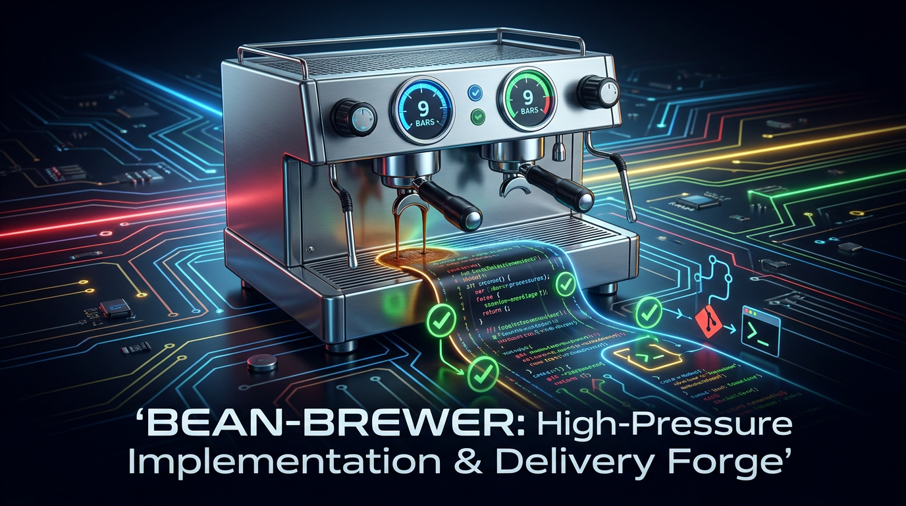
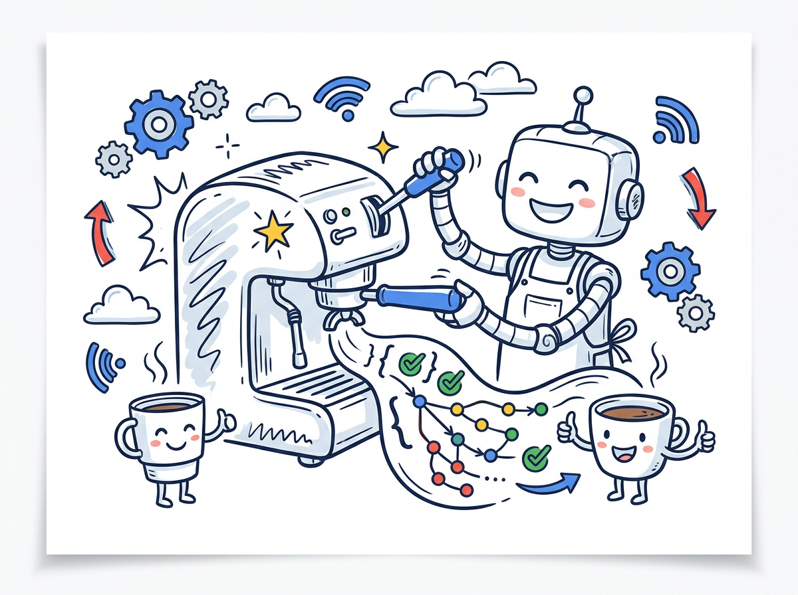

<p align="center">
  
</p>

# ☕ Bean-Brewer

> **High-Pressure Implementation Forge: Technical extraction, architectural contracts, TDD code loops, and Git PR delivery (Stages 3–9).**

---

## ☕ Why "The Brewer"? (The Metaphor Explained)

<p align="center">
  
</p>

In specialty coffee brewing, the espresso machine is where preparation turns into reality. Under 9 bars of controlled pressure and calibrated temperature, hot water is forced through tamped grounds to extract oils, soluble flavors, and dense golden crema.

In software engineering, **`bean-brewer`** is the execution forge:
- It takes an approved `02_PRD.md` (roasted by `bean-roaster` or milled by `bean-grinder`).
- Under rigorous test-driven discipline, it extracts existing codebase contracts, designs target specifications (`04_SPEC.md`), slices tasks into vertical units (`05_PLAN.md`), and unleashes autonomous engineering subagents to write and audit code (`app_build/`).
- It captures verifiable terminal walkthroughs (`/record`) and packages atomic, conventional commits into rich GitHub Pull Requests.

---

## 🏛️ Origin & Architectural Rationale

### Spawned from `bean-to-cup`
**`bean-brewer`** was extracted from the monolithic [`bean-to-cup`](https://github.com/sapientcoffee/bean-to-cup) repository as part of a modular decomposition of the Antigravity barista swarm.

### Why Decompose?
1. **Developer & CI/CD Isolation:** Software engineers and automated execution loops only need the implementation, testing, and git delivery suite—without the overhead of product discovery or incident management plugins.
2. **Lean Plugin Footprint:** Decouples 12 heavy engineering skills, 8 subagents, terminal recorders, and git hook scripts from the rest of the workspace.
3. **Strict Contract Handoffs:** Consumes standardized `02_PRD.md` files as an immutable contract, guaranteeing that execution cannot begin without validated requirements.
4. **Independent Tooling Evolution:** Worktree management, testing harnesses, and terminal recording engines can evolve and upgrade without risking stability in discovery or monitoring tools.

---

## 🚀 Capabilities & Stages Reference (Stages 3–9)

| Stage | Skill / Agent | Description |
| :---: | :--- | :--- |
| **3** | **`research` (`skills/research`)** | Blind, factual codebase analysis. Extracts existing models, routes, and schemas into `03_EXTRACTION.md`. |
| **4** | **`@architect` (`agents/system-design.md`)** | System architecture specification. Emits physical schema contracts in `contracts/` and documents target architecture in `04_SPEC.md`. |
| **5** | **`@architect` (`skills/sync`)** | Cuts vertical implementation slices, performs dependency mapping in `05_PLAN.md`, and synchronizes tasks to GitHub issues. |
| **6** | **Human Review Gate (🛑) & `cycle-telemetry`** | Halts execution to present spec and plan for approval. Measures human waiting time vs compute time (Velocity Chess Clock). |
| **7** | **`@engineer`, `code-hygiene`, `@contract-auditor`, `harness-immunizer`** | Autonomous TDD execution loops. Decouples deterministic linters (`code-hygiene`) from isolated contract compliance (`@contract-auditor`). Triggers self-healing (`harness-immunizer`) on >2 failed retries. |
| **8** | **`record` & `@execution-verifier`** | Captures terminal playbacks (`08_WALKTHROUGH.md`). Subagent `@execution-verifier` (Velocity Reaper) acts as anti-bypass guardrail before Stage 9. |
| **9** | **`git-delivery` & `github-workflow`** | Uses git worktrees (`worktree`) and GitHub CLI (`gh`) to create atomic conventional commits and raise rich "What, Why, How" Pull Requests. |
| **Misc** | **`archive`, `motivate`** | Moves spent grounds into `./plans/archive/` and delivers coffee-themed encouragement. |

---

## 🤖 Barista Engineering Swarm

`bean-brewer` provides 10 specialized subagents ready for dispatch:
- **`@architect`**: System design and physical contract modeling.
- **`@engineer`**: Test-driven implementation and code generation.
- **`@auditor`**: Quality verification and regression testing.
- **`@contract-auditor`**: Isolated architectural contract auditor checking route & schema compliance against `contracts/`.
- **`@execution-verifier`**: Velocity Reaper anti-bypass guardrail verifying physical test passes and coverage integrity.
- **`@code-review`**: Code inspection and standards auditing.
- **`@scout`**: Blind AST exploration and fact gathering.
- **`@codebase-analyzer`**: Static analysis and architectural topology mapping.
- **`@context-mapping`**: Bounded context and dependency analysis.
- **`@pattern-recognition`**: Design pattern and architectural smell identification.

---

## 🔄 Detailed High-Pressure Execution Workflow

```mermaid
flowchart TD
    subgraph Inputs["📥 Inbound Contract"]
        PRD["02_PRD.md<br/>(from bean-roaster or bean-grinder)"]
        RepoSource["Existing Source Codebase"]
    end

    subgraph Stage3["Stage 3: Extraction (/research)"]
        ScoutAgent["@scout & @codebase-analyzer"]
        ASTExtract["Factual AST Discovery & Route Mapping"]
        EmitExtraction["Emit: 03_EXTRACTION.md"]
    end

    subgraph Stage4["Stage 4: Specification (@architect)"]
        PatternAgent["@pattern-recognition & @context-mapping"]
        TargetArch["Target Architecture & Threat Model"]
        Contracts["Physical Schema Contracts<br/>Emit: contracts/"]
        EmitSpec["Emit: 04_SPEC.md"]
    end

    subgraph Stage5["Stage 5: Execution Planning (@architect)"]
        VerticalSlicing["Decompose into Atomic Vertical Slices"]
        DepGraph["Dependency & Critical Path Analysis"]
        EmitPlan["Emit: 05_PLAN.md"]
        SyncIssues["sync Skill (Sync to GitHub Issues)"]
    end

    subgraph Gate6["🛑 Stage 6: Human Review Gate (Chess Clock)"]
        HumanReview{"Explicit Approval Needed<br/>(cycle-telemetry: human_wait)"}
        RevisePlan["Revise Plan or Spec"]
        Proceed["Approved to Implement"]
    end

    subgraph Stage7["Stage 7: Decoupled TDD Implementation Loop"]
        Worktree["worktree Skill (Isolate Branch in Git Worktree)"]
        Engineer["@engineer Subagent (generate-code)"]
        Hygiene["code-hygiene Skill (Deterministic Non-LLM Linters)"]
        ContractAudit["@contract-auditor Subagent (Verify contracts/)"]
        APITest["test:api Skill & build:production"]
        TDDLoop{"Tests, Hygiene & Contracts Pass?"}
        HarnessPatch["harness-immunizer Skill<br/>(Self-Healing Gotcha Patch on >2 Retries)"]
        EmitVerification["Emit: 07_VERIFICATION.md<br/>(Appends Cycle Telemetry)"]
    end

    subgraph Stage8["Stage 8: Walkthrough & Anti-Bypass Guardrail"]
        Asciinema["record Skill (Asciinema Session)"]
        RenderGIF["Compile to Animated .gif & .cast"]
        EmitWalkthrough["Emit: 08_WALKTHROUGH.md"]
        ReaperGate["@execution-verifier Subagent<br/>(Adversarial Reaper Check: Exit Code 0, Zero Skips, Coverage Truth)"]
        ReaperVerdict{"Reaper Verdict"}
    end

    subgraph Stage9["Stage 9: Git Delivery & PR"]
        GitDelivery["git-delivery & github-workflow"]
        AtomicCommits["Conventional Atomic Commits"]
        GitHubPR["gh pr create (Rich What-Why-How PR)"]
        ArchivePlan["archive Skill (Move to ./plans/archive/)"]
    end

    PRD & RepoSource --> ScoutAgent
    ScoutAgent --> ASTExtract --> EmitExtraction
    EmitExtraction --> PatternAgent
    PatternAgent --> TargetArch --> Contracts --> EmitSpec
    EmitSpec --> VerticalSlicing --> DepGraph --> EmitPlan
    EmitPlan --> SyncIssues
    EmitPlan --> HumanReview
    HumanReview -->|Changes Requested| RevisePlan --> TargetArch
    HumanReview -->|Approved| Proceed
    Proceed --> Worktree
    Worktree --> Engineer
    Engineer --> Hygiene --> ContractAudit --> APITest --> TDDLoop
    TDDLoop -->|Failures <= 2| Engineer
    TDDLoop -->|Failures > 2| HarnessPatch --> Engineer
    TDDLoop -->|All Passing| EmitVerification
    EmitVerification --> Asciinema
    Asciinema --> RenderGIF --> EmitWalkthrough
    EmitWalkthrough --> ReaperGate
    ReaperGate --> ReaperVerdict
    ReaperVerdict -->|REJECTED: Bypass/Fail| Engineer
    ReaperVerdict -->|APPROVED| GitDelivery
    GitDelivery --> AtomicCommits --> GitHubPR --> ArchivePlan
```



---

## 🔌 Decoupled Telemetry

`bean-brewer` includes `scripts/sync_dashboard_if_available.py`:
- Automatically updates `visual-dashboard.html` in `bean-cup` if installed.
- Silently succeeds if `bean-cup` is absent, allowing pure standalone headless execution in CI or isolated environments.

---

## 📦 Installation

```bash
# Install to local Antigravity plugin registry
./install.sh

# Or install via agy CLI
agy plugin install .
```

---

## 📜 License
Apache-2.0 - Copyright 2026 Google LLC.
