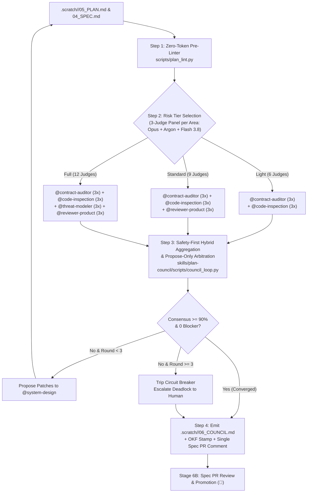

<!--
Copyright 2026 Google LLC

Licensed under the Apache License, Version 2.0 (the "License");
you may not use this file except in compliance with the License.
You may obtain a copy of the License at

    https://www.apache.org/licenses/LICENSE-2.0

Unless required by applicable law or agreed to in writing, software
distributed under the License is distributed on an "AS IS" BASIS,
WITHOUT WARRANTIES OR CONDITIONS OF ANY KIND, either express or implied.
See the License for the specific language governing permissions and
limitations under the License.
-->

# 🏛️ Skill: Stage 6A Plan Review Council (`plan-council`)

You are executing the **Plan Review Council** skill. This skill runs pre-PR (or prior to Spec PR human sign-off) to validate `.scratch/<id>/04_SPEC.md` and `.scratch/<id>/05_PLAN.md`, coordinate risk-tiered evidence-based reviewers, emit `.scratch/<id>/06_COUNCIL.md` with an OKF stamp, and publish a single consolidated summary comment on the Spec PR.



---

## ⚡ Operational Protocol

### Step 1: Run Deterministic Pre-Linter (0 Tokens)
Before spending LLM context or dispatching subagents, execute:
```bash
python3 scripts/plan_lint.py --plan ".scratch/<id>/05_PLAN.md"
```
The pre-linter checks:
- **TDD Pairing**: Every slice must declare test seams (`SEAM-01..N`) and verification commands.
- **DAG Acyclicity**: Kahn's algorithm validates slice dependencies (`*Depends On:*`).
- **PRD Traceability**: Verifies `Covers: AC1, AC2` references map to `.scratch/<id>/03_PRD.md`.
- **Contract Coverage**: Flags unreferenced schema files in `.scratch/<id>/contracts/`.

---

### Step 2: Risk-Based Council Sizing & 3-Judge Panel per Analysis Area

Every active analysis area is evaluated in parallel by a **3-Judge Panel** combining frontier model diversity:
1. **Judge 1 (`opus`)**: **Claude Opus** (`Model: "pro"`) — deep structural & edge-case reasoning.
2. **Judge 2 (`argon`)**: **Gemini 4 Argon** (`Model: "inherit"`) — balanced architectural & spec-traceability synthesis.
3. **Judge 3 (`flash-3.8`)**: **Gemini 3.8 Flash** (`Model: "flash"`) — high-speed adversarial lint & contract surface scanning.

The pre-linter recommends one of three risk tiers based on change complexity:

| Tier | Trigger | Active Analysis Areas | 3-Judge Panel Dispatch |
| :--- | :--- | :--- | :--- |
| **Light** | $\le 3$ slices, zero schema/contract changes | `@contract-auditor`, `@code-inspection` | 2 areas $\times$ 3 judges = **6 judge subagents** |
| **Standard** | 4–10 slices or new API endpoints | `@contract-auditor`, `@code-inspection`, `@reviewer-product` | 3 areas $\times$ 3 judges = **9 judge subagents** |
| **Full** | Auth, data migration, security boundary, or $>10$ slices | `@contract-auditor`, `@code-inspection`, `@threat-modeler`, `@reviewer-product` (+ `@review-arbiter`) | 4 areas $\times$ 3 judges = **12 judge subagents** |

---

### Step 3: Evidence-Based Reviewer Execution & Safety-First Hybrid Aggregation

When dispatching the 3 judges per analysis area via `invoke_subagent`:
1. **Mandatory Line Quotes**: Every finding MUST cite a direct quotation from `.scratch/<id>/04_SPEC.md`, `contracts/`, or `.scratch/<id>/05_PLAN.md`. Findings without citations are discarded.
2. **Finding Cap**: Maximum 5 findings per judge per round. "No findings" is a preferred outcome.
3. **Strict Severity Calibration**:
   - `CRITICAL`: Blocks Stage 7 execution, causes data loss, or breaks security boundaries.
   - `HIGH`: Guaranteed implementation rework or missing integration test fixtures.
   - `MEDIUM`: Suboptimal efficiency or unverified secondary edge case.
   - `LOW`: Cosmetic or documentation clarification.
4. **Safety-First Hybrid Aggregation (`aggregate_area_judges`)**:
   - **Cross-Judge Deduplication**: Equivalent findings reported by multiple judges within an area (matching `id`, normalized `quote`, `line`, or `target_task` + token Jaccard $\ge 0.45$) are merged into a single finding annotated with `agreement` (`"3/3"`, `"2/3"`, or `"1/3"`) and `judges` (`["argon", "flash-3.8", "opus"]`) so consensus penalties are deducted **only once per unique defect**.
   - **1-of-3 Blocker Recall (`CRITICAL` / `HIGH`)**: Any `CRITICAL` or `HIGH` finding reported by $\ge 1$ judge (`1/3`) is surfaced so high-severity risks are never suppressed by majority vote.
   - **2-of-3 Majority Quorum (`MEDIUM` / `LOW`)**: `MEDIUM` and `LOW` findings require $\ge 2$ of 3 judges (`2/3`) to pass; single-judge (`1/3`) `MEDIUM`/`LOW` noise is filtered into `filtered_minority_findings`.

---

### Step 4: Propose-Only Arbitration Loop

Reviewers and arbiters **never overwrite `.scratch/<id>/05_PLAN.md` directly**.
1. Aggregated findings are processed via:
   ```bash
   python3 skills/plan-council/scripts/council_loop.py --plan ".scratch/<id>/05_PLAN.md" --tier "Standard" --round 1
   ```
2. The arbiter calculates the consensus score:
   $$\text{Score} = \max(0, 100 - 25C - 10H - 3M - 1L)$$
3. If score $< 90\%$ or any Critical/High findings persist, structured proposals (`PROP-01`, `PROP-02`) are presented to `@system-design` to accept or reject with technical rationale.
4. If round reaches 3 without convergence, the **Circuit Breaker** trips, escalating trade-offs to the human gate.

---

### Step 5: Emit `.scratch/<id>/06_COUNCIL.md`, Stamp OKF, & Comment on Spec PR

1. Write `.scratch/<id>/06_COUNCIL.md` containing:
   - Section 1: 🛑 **Decisions Requiring Human Judgment** (Stage 6B sign-off).
   - Section 2: ⚖️ **Arbiter Hardening Proposals**.
   - Section 3: 📊 **Stakeholder Scorecard & Consensus Score**.
2. Stamp OKF frontmatter:
   ```bash
   python3 scripts/okf.py stamp --file ".scratch/<id>/06_COUNCIL.md" --doc-type "council" --status "Complete"
   ```
3. **Pre-PR Execution & Single Summary Comment**:
   - Run the council pre-PR so human reviewers receive a hardened Spec PR.
   - When a Spec PR is open, post **one consolidated summary comment** on the Spec PR (`gh pr comment <pr-number> --body-file .scratch/<id>/06_COUNCIL.md`) rather than noisy inline comments.

---

### Step 6: Antigravity Enterprise `/teamwork` Execution Mode (Carafe / Full Tier)

When executing Stage 6A in **Antigravity (`agy`)**, choose the orchestration mode that matches the brew tier:

1. **`invoke_subagent` Mode (Cortado / Light & Standard Tiers, or Automated Batch Runs)**:
   - Use standard parallel `invoke_subagent` fan-out for **Light** (6 judges) and **Standard** (9 judges) tiers, or whenever deterministic non-interactive batch execution is required.
   - Each judge runs in an isolated subagent context and returns structured JSON findings to `skills/plan-council/scripts/council_loop.py`.

2. **Enterprise `/teamwork` Mode (Carafe / Full Council with High Architectural Blast Radius)**:
   - Recommend `/teamwork` for **Carafe / Full Tier** specs touching authentication boundaries, multi-service schemas, or data migrations where live multi-agent debate resolves cross-cutting trade-offs faster than multi-round batch retries.
   - **`/teamwork` Council Roster**:
     - **`@system-design` (Plan Owner)**: Defends `.scratch/<id>/04_SPEC.md`, `.scratch/<id>/contracts/`, and `.scratch/<id>/05_PLAN.md`, and negotiates minimal structural patches in real time.
     - **`@contract-auditor`**: Audits physical schema contracts (`contracts/`) and boundary compatibility.
     - **`@code-inspection`**: Audits TDD seam pairing (`SEAM-01..N`), failure modes, and runtime edge cases.
     - **`@threat-modeler`**: Audits privilege boundaries, trust zones, and injection/data-exposure surfaces.
     - **`@reviewer-product`**: Audits verbatim `AC1..ACN` coverage and user-journey completeness.
     - **`@review-arbiter` (Chair)**: Moderates peer-to-peer cross-examination via `send_message`, enforces evidence citations and severity calibration, runs `skills/plan-council/scripts/council_loop.py` to record consensus, and stamps `.scratch/<id>/06_COUNCIL.md`.
