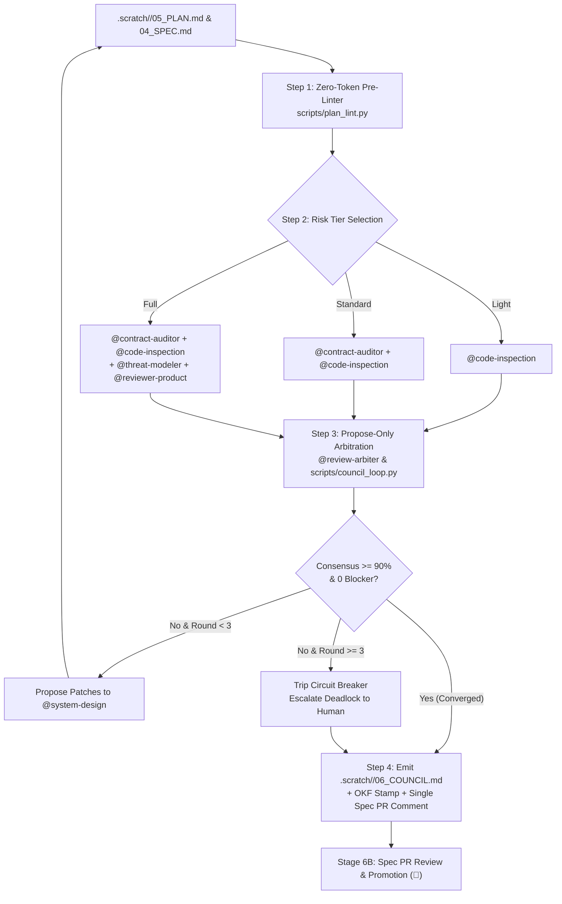

<!--
Copyright 2026 Google LLC

Licensed under the Apache License, Version 2.0 (the "License");
you may not use this file except in compliance with the License.
You may obtain a copy of the License at

    https://www.apache.org/licenses/LICENSE-2.0

Unless required by applicable law or agreed to in writing, software
distributed under the License is distributed on an "AS IS" BASIS,
WITHOUT WARRANTIES OR CONDITIONS OF ANY KIND, either express or implied.
See the License for the specific language governing permissions and
limitations under the License.
-->

# 🏛️ Skill: Stage 6A Plan Review Council (`plan-council`)

You are executing the **Plan Review Council** skill. This skill runs pre-PR (or prior to Spec PR human sign-off) to validate `.scratch/<id>/04_SPEC.md` and `.scratch/<id>/05_PLAN.md`, coordinate risk-tiered evidence-based reviewers, emit `.scratch/<id>/06_COUNCIL.md` with an OKF stamp, and publish a single consolidated summary comment on the Spec PR.



---

## ⚡ Operational Protocol

### Step 1: Run Deterministic Pre-Linter (0 Tokens)
Before spending LLM context or dispatching subagents, execute:
```bash
python3 scripts/plan_lint.py --plan ".scratch/<id>/05_PLAN.md"
```
The pre-linter checks:
- **TDD Pairing**: Every slice must declare test seams (`SEAM-01..N`) and verification commands.
- **DAG Acyclicity**: Kahn's algorithm validates slice dependencies (`*Depends On:*`).
- **PRD Traceability**: Verifies `Covers: AC1, AC2` references map to `.scratch/<id>/03_PRD.md`.
- **Contract Coverage**: Flags unreferenced schema files in `.scratch/<id>/contracts/`.

---

### Step 2: Risk-Based Council Sizing

The pre-linter recommends one of three tiers based on change complexity:

| Tier | Trigger | Active Reviewers |
| :--- | :--- | :--- |
| **Light** | $\le 3$ slices, zero schema/contract changes | `@code-inspection` |
| **Standard** | 4–10 slices or new API endpoints | `@contract-auditor` and `@code-inspection` |
| **Full** | Auth, data migration, security boundary, or $>10$ slices | `@contract-auditor`, `@code-inspection`, `@threat-modeler`, `@reviewer-product`, `@review-arbiter` |

---

### Step 3: Evidence-Based Reviewer Execution Rules

When dispatching reviewers via `invoke_subagent`:
1. **Mandatory Line Quotes**: Every finding MUST cite a direct quotation from `.scratch/<id>/04_SPEC.md`, `contracts/`, or `.scratch/<id>/05_PLAN.md`. Findings without citations are discarded.
2. **Finding Cap**: Maximum 5 findings per reviewer per round. "No findings" is a preferred outcome.
3. **Strict Severity Calibration**:
   - `CRITICAL`: Blocks Stage 7 execution, causes data loss, or breaks security boundaries.
   - `HIGH`: Guaranteed implementation rework or missing integration test fixtures.
   - `MEDIUM`: Suboptimal efficiency or unverified secondary edge case.
   - `LOW`: Cosmetic or documentation clarification.

---

### Step 4: Propose-Only Arbitration Loop

Reviewers and arbiters **never overwrite `.scratch/<id>/05_PLAN.md` directly**.
1. Aggregated findings are processed via:
   ```bash
   python3 scripts/council_loop.py --plan ".scratch/<id>/05_PLAN.md" --tier "Standard" --round 1
   ```
2. The arbiter calculates the consensus score:
   $$\text{Score} = \max(0, 100 - 25C - 10H - 3M - 1L)$$
3. If score $< 90\%$ or any Critical/High findings persist, structured proposals (`PROP-01`, `PROP-02`) are presented to `@system-design` to accept or reject with technical rationale.
4. If round reaches 3 without convergence, the **Circuit Breaker** trips, escalating trade-offs to the human gate.

---

### Step 5: Emit `.scratch/<id>/06_COUNCIL.md`, Stamp OKF, & Comment on Spec PR

1. Write `.scratch/<id>/06_COUNCIL.md` containing:
   - Section 1: 🛑 **Decisions Requiring Human Judgment** (Stage 6B sign-off).
   - Section 2: ⚖️ **Arbiter Hardening Proposals**.
   - Section 3: 📊 **Stakeholder Scorecard & Consensus Score**.
2. Stamp OKF frontmatter:
   ```bash
   python3 scripts/okf.py stamp --file ".scratch/<id>/06_COUNCIL.md" --doc-type "council" --status "Complete"
   ```
3. **Pre-PR Execution & Single Summary Comment**:
   - Run the council pre-PR so human reviewers receive a hardened Spec PR.
   - When a Spec PR is open, post **one consolidated summary comment** on the Spec PR (`gh pr comment <pr-number> --body-file .scratch/<id>/06_COUNCIL.md`) rather than noisy inline comments.
