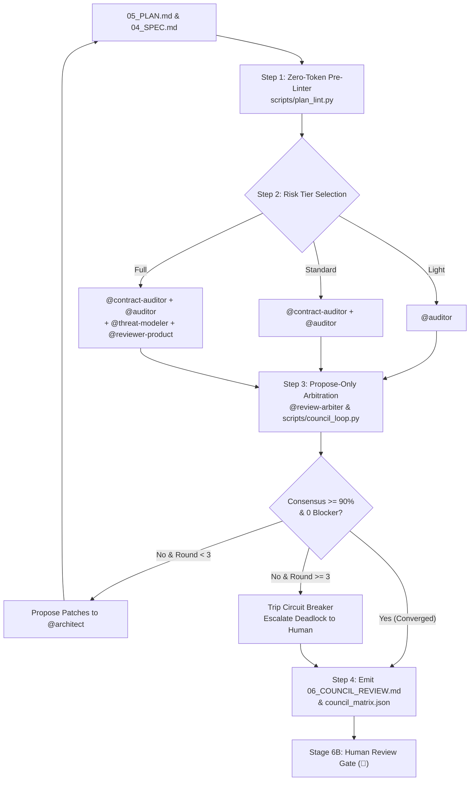

<!--
Copyright 2026 Google LLC

Licensed under the Apache License, Version 2.0 (the "License");
you may not use this file except in compliance with the License.
You may obtain a copy of the License at

    https://www.apache.org/licenses/LICENSE-2.0

Unless required by applicable law or agreed to in writing, software
distributed under the License is distributed on an "AS IS" BASIS,
WITHOUT WARRANTIES OR CONDITIONS OF ANY KIND, either express or implied.
See the License for the specific language governing permissions and
limitations under the License.
-->

# 🏛️ Skill: Stage 6A Plan Review Council

You are executing the **Plan Review Council** skill. This skill bridges Stage 5 (Execution Planning) and Stage 6B (Human Review Gate). It ensures execution roadmaps are hardened against missing test fixtures, circular dependencies, auth blind spots, and scope creep *before* human attention is requested or code generation begins.



---

## ⚡ Operational Protocol

### Step 1: Run Deterministic Pre-Linter (0 Tokens)
Before spending LLM context or dispatching subagents, execute:
```bash
python3 scripts/plan_lint.py --plan "plans/<feature>/<timestamp>/05_PLAN.md"
```
The pre-linter checks:
- **TDD Pairing**: Every implementation task must have declared test/verification criteria.
- **DAG Acyclicity**: Kahn's algorithm validates task dependencies (`*Depends On:*`).
- **PRD Traceability**: Verifies user stories are tracked.
- **Contract Coverage**: Flags unreferenced schema files in `contracts/`.

If linting fails, halt and instruct `@architect` to resolve structural plan defects.

---

### Step 2: Risk-Based Council Sizing

The pre-linter recommends one of three tiers based on change complexity:

| Tier | Trigger | Active Reviewers |
| :--- | :--- | :--- |
| **Light** | $\le 3$ tasks, zero schema/contract changes | `@auditor` |
| **Standard** | 4–10 tasks or new API endpoints | `@contract-auditor` and `@auditor` |
| **Full** | Auth, data migration, security boundary, or $>10$ tasks | `@contract-auditor`, `@auditor`, `@threat-modeler`, `@reviewer-product`, `@review-arbiter` |

---

### Step 3: Evidence-Based Reviewer Execution Rules

When dispatching reviewers via `invoke_subagent`:
1. **Mandatory Line Quotes**: Every finding MUST cite a direct quotation from `04_SPEC.md`, `contracts/`, or `05_PLAN.md`. Findings without citations are discarded.
2. **Finding Cap**: Maximum 5 findings per reviewer per round. "No findings" is a preferred outcome.
3. **Strict Severity Calibration**:
   - `CRITICAL`: Blocks Stage 7 execution, causes data loss, or breaks security boundaries.
   - `HIGH`: Guaranteed implementation rework or missing integration test fixtures.
   - `MEDIUM`: Suboptimal efficiency or unverified secondary edge case.
   - `LOW`: Cosmetic or documentation clarification.

---

### Step 4: Propose-Only Arbitration Loop

Reviewers and arbiters **never overwrite `05_PLAN.md` directly**.
1. Aggregated findings are processed via:
   ```bash
   python3 scripts/council_loop.py --plan "plans/<feature>/<timestamp>/05_PLAN.md" --tier "Standard" --round 1
   ```
2. The arbiter calculates the consensus score:
   $$\text{Score} = \max(0, 100 - 25C - 10H - 3M - 1L)$$
3. If score $< 90\%$ or any Critical/High findings persist, structured proposals (`PROP-01`, `PROP-02`) are presented to `@architect` to accept or reject with technical rationale.
4. If round reaches 3 without convergence, the **Circuit Breaker** trips, escalating trade-offs to the human gate.

---

### Step 5: Emitted Artifacts

The council writes:
1. `plans/<feature>/<timestamp>/06_COUNCIL_REVIEW.md`:
   - Section 1: 🛑 **Decisions Requiring Human Judgment** (Stage 6B sign-off).
   - Section 2: ⚖️ **Arbiter Hardening Proposals for `@architect`**.
   - Section 3: 📊 **Stakeholder Scorecard & Consensus Score**.
   - Section 4: 🛡️ **Immunized Gotchas Evaluated** (from `rules/gotchas/`).
2. `plans/<feature>/<timestamp>/council_matrix.json`: Machine-readable score matrix.
3. Mirror to `<appDataDir>/brain/<conversation-id>/06_council_review.md`.

Once emitted, the process transitions to **Stage 6B (Human Review Gate)**. After human sign-off, **Stage 6C (`skills/sync`)** provisions GitHub issues from the final, approved tasks.
